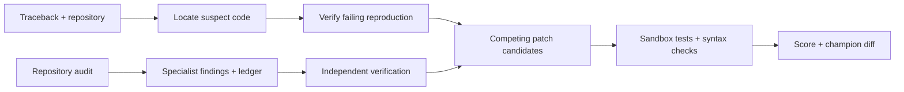

<div align="center">

# BugArena MCP

**Find the defect. Reproduce it. Let competing patches prove themselves.**

A Python-focused Model Context Protocol server for evidence-driven audits and repair tournaments.

[Quickstart](#quickstart) · [Features](#features) · [Tools](#mcp-tools) · [Proof](docs/evidence.md) · [Architecture](docs/architecture.md) · [Contributing](CONTRIBUTING.md)

**Python 3.11+ · 13 MCP tools · 4 repair personas · 9 audit sweep roles**

</div>

## What it does

Give BugArena a Python traceback and a local repository. It can locate suspect code, synthesize a failing reproduction, evaluate competing unified diffs against tests, and return a ranked report with a champion patch. Supply patches yourself or explicitly enable model generation.

For broader investigation, start an audit: specialist roles produce a persistent finding ledger, deduplicate related findings, run verification probes, and track which repository areas were examined.

**Status: 0.1.0.** This is an evolving Python repair tool. Test outcomes support individual candidates; they do not guarantee that arbitrary repositories are bug-free. [Evidence and limits →](docs/evidence.md)



## Choose your workflow

| I want to… | Start here |
| --- | --- |
| Investigate a traceback | `bug_detect`, then `generate_bug_report` |
| Prove a suspected defect | `bug_reproduce` |
| Compare fixes | `agent_fix_tournament` → `evaluate_patches` → `generate_fix_report` |
| Run the combined repair flow | `bugarena_autonomous_repair` |
| Audit without model calls | `audit_start` → `audit_round` with `auto_generate=false` |
| Inspect and verify findings | `audit_status`, `finding_verify`, `audit_report` |
| Evaluate fixes for confirmed findings | `fix_loop_start` |

## Features

| Capability | What you get | Inspect the proof |
| --- | --- | --- |
| Traceback-to-code triage | Python stack frames mapped to AST scopes | [Discovery tests](tests/unit/test_discovery.py) |
| Reproduction before repair | A generated pytest reproduction with a checked failing baseline | [Baseline tests](tests/regression/test_ecc_010_red_validator.py) |
| Four repair approaches | Surgical Minimalist, Defensive Guardian, Architectural Fixer, Contract Enforcer | [Personas](src/bugarena/tournament/personas/base.py) |
| Executable patch selection | Reproduction, regressions, syntax, churn and complexity | [End-to-end fixture](tests/integration/test_e2e_autonomous_repair.py) |
| Persistent audit workflow | Finding states, deduplication, independent verification and area coverage | [Audit tests](tests/unit/test_audit_engine.py) |
| Optional model generation | Gemini, OpenAI, DeepSeek, Groq and Ollama dispatch implementations | [Provider tests](tests/regression/test_ecc_039_provider_negative_paths.py) |
| Inspectable outputs | Markdown, JSON and unified diffs, depending on the tool | [Tool reference](docs/tools.md) |

### How it differs from other MCP tools

BugArena focuses on **comparing candidate repairs using executable reproduction and regression checks**, alongside an evidence-graded audit ledger. Its local integration fixture accepts a small calculator fix and disqualifies a competing patch that breaks an existing test.

Semgrep's current MCP integration emphasizes security scanning and agent-assisted remediation. Sentry's MCP exposes production errors, performance data and issue triage. These are complementary workflows. No head-to-head benchmark establishes better detection accuracy or repair success for BugArena. [Sourced comparison and reproducible proof →](docs/evidence.md)

## Quickstart

You need Python 3.11+, Git, and an MCP client that can start a local stdio server. Clone this repository using GitHub's **Code → Clone** command, then open a terminal in its root.

<details open>
<summary><strong>Windows / PowerShell</strong></summary>

```powershell
py -3.11 -m venv .venv
.\.venv\Scripts\python.exe -m pip install -e .
.\.venv\Scripts\bugarena.exe
```

</details>

<details>
<summary><strong>macOS / Linux</strong></summary>

```bash
python3 -m venv .venv
.venv/bin/python -m pip install -e .
.venv/bin/bugarena
```

</details>

The server waits for MCP messages over stdin/stdout; it does not open a web page. `python -m bugarena.server` also works with the installed environment's Python.

<details>
<summary><strong>Connect an MCP client</strong></summary>

For clients accepting `mcpServers`, replace the executable path below with your absolute virtual-environment path. Other clients may use a different configuration envelope; the command and arguments are the same.

```json
{
  "mcpServers": {
    "bugarena": {
      "command": "<absolute-repo-path>/.venv/Scripts/python.exe",
      "args": ["-m", "bugarena.server"]
    }
  }
}
```

On macOS/Linux use `<absolute-repo-path>/.venv/bin/python`. Reload the client's MCP connection and inspect its tool list for the 13 tools below.

</details>

<details>
<summary><strong>API keys and optional generation</strong></summary>

Manual candidate evaluation and offline audit roles require no LLM API key. Generation is opt-in through `auto_generate=true`.

Set the applicable `GEMINI_API_KEY`, `OPENAI_API_KEY`, `DEEPSEEK_API_KEY` or `GROQ_API_KEY` in the server environment. [.env.example](.env.example) lists key names. With an editable installation, the loader also checks the project-root `.env` and `~/.gemini/.env`; it does not load an arbitrary target repository's `.env`.

Provider support means dispatch code exists; it does not certify current model availability, account access or quotas. [Configuration and isolation →](docs/configuration.md)

</details>

### Try an audit

Ask your MCP client:

> Use BugArena to start a read-only audit of my repository. Run one round with auto_generate=false, show confirmed and unverified findings separately, and explain the evidence for each finding.

Or send these calls in sequence, replacing placeholders with your repository path and returned run ID:

```json
{"tool": "audit_start", "arguments": {"repo_path": "<absolute-target-repo>", "mode": "read_only", "max_rounds": 2}}
{"tool": "audit_round", "arguments": {"run_id": "<returned-run-id>", "auto_generate": false}}
{"tool": "audit_status", "arguments": {"run_id": "<returned-run-id>"}}
```

These illustrate tool names and arguments; use your client's MCP interface to send them. Read-only audit mode can execute probes and create audit state. See [execution boundaries](docs/configuration.md#execution-boundaries).

## MCP tools

| Tool | Purpose |
| --- | --- |
| `bug_detect` | Locate suspects from a traceback |
| `bug_reproduce` | Generate and validate a failing reproduction |
| `agent_fix_tournament` | Register supplied or generated patch candidates |
| `evaluate_patches` | Evaluate patches in temporary workspaces |
| `generate_fix_report` | Export leaderboard and champion patch |
| `generate_bug_report` | Save a diagnostic Markdown report |
| `bugarena_autonomous_repair` | Coordinate the repair lifecycle |
| `audit_start` | Create an audit run |
| `audit_round` | Run a specialist sweep and verification round |
| `audit_status` | Inspect finding counts and area coverage |
| `finding_verify` | Reverify one finding independently |
| `audit_report` | Render the audit ledger |
| `fix_loop_start` | Evaluate candidate repairs for confirmed findings |
| `session_prepare` | Detect browsers/API keys and return the pre-start questionnaire |
| `session_confirm` | Validate answers, enforce passive/full access policy, and write `scope_and_authorization.md` |
| `site_audit_start` | Launch authorized multi-browser CDP audit and collect DevTools telemetry |
| `site_audit_round` | Execute another multi-browser verification and honesty-audit round |
| `site_audit_status` | Return claim counts and `EvidenceVault` hash-chain integrity |
| `browser_cursor_list` | List isolated `[mcp_<browser>]` cursors, PIDs, and ports |
| `inspect_panel` | Inspect a targeted DevTools panel on a granted browser |
| `project_audit_start` | Audit local source code and link site findings via source maps |
| `report_build` | Build `REPORT.md`, Chromium `REPORT.pdf`, `report.json`, and finding folders |
| `verify_pack_build` | Generate stdlib-only offline `verify/verify.py` and `VERIFY_PROMPT.md` |
| `claim_retract` | Retract a claim into immutable `corrections_log.md` |
| `agent_scoreboard` | Return per-agent honesty, precision, and Brier calibration scores |
| `merge_both_skills` | Quarantine, scan, compatibility-test, and merge an external skill with BugArena primary |

[Full signatures, defaults and descriptions →](docs/tools.md)

## Understand the score

A candidate that fails its reproduction or has failing regression checks is disqualified. Evaluation also rejects invalid Python syntax. Eligible patches receive weighted points for reproduction (40), regression tests (30), small diffs (15), complexity (10), and mutation testing (5).

Missing regression tests earn no regression points. Unmeasured mutation testing earns no mutation points; the current evaluator does not run a mutation engine. A score is a ranking heuristic, not a probability of correctness. [Formula and limitations →](docs/architecture.md#scoring)

## Repository guide

| Location | Contents |
| --- | --- |
| [src/bugarena](src/bugarena) | Server and focused Python subsystems |
| [tests](tests) | Unit, regression and end-to-end fixtures |
| [docs](docs/README.md) | Guides, evidence, architecture and tool reference |
| [scripts](scripts) | Developer utilities |
| [.agents/skills](.agents/skills) | Agent workflow instructions |

[Contributor guide](CONTRIBUTING.md) · [Repository review](docs/repository-review.md) · [Evidence and known limits](docs/evidence.md)

## Contributors

- **[ChatGPT by OpenAI](https://chatgpt.com/)** — AI-assisted repository review, documentation, organization, and validation through Codex, under the repository owner's direction.

No license file is currently included; a maintainer needs to choose and add one. The previous unsupported MIT label has been removed.

[Back to top ↑](#bugarena-mcp)
